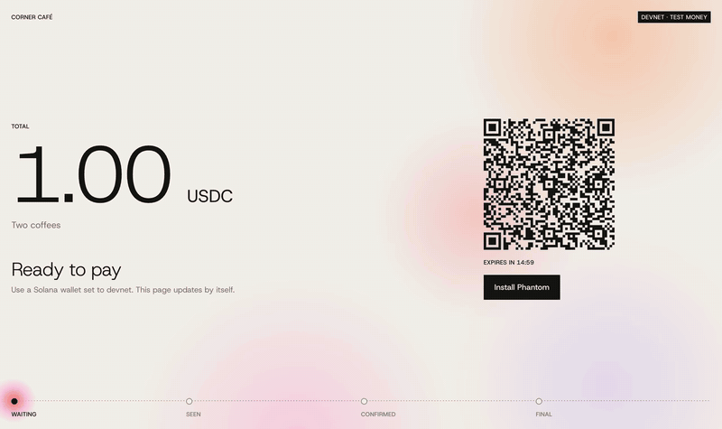

# Solana Checkout



Live at [solana-checkout.pages.dev](https://solana-checkout.pages.dev). It runs on devnet, so the money is fake.

I've been working in payments and knew nothing about Solana, so I built a checkout to learn how it works. You create a payment link, someone pays it in USDC, and the page follows the payment on the chain until it's final. Everything runs in the browser, with no backend.

The recording replays [a real payment](https://explorer.solana.com/tx/4jYHFX8DW8hr9qWQ34qhLxAfqwo85u4oA6rjPoa1AhKZaaGwhNbNxLbHA56cEKLfLn6DLziTpTKcRww1GCZUk4qT?cluster=devnet) with the steps slowed down so you can see each one.

## What I found interesting

Coming from cards, the fun part was what's missing. There are no chargebacks, so a refund is just a new payment back. There's no processor webhook either, so the app attaches a random reference to each payment and looks for it on the chain, a bit like a payment intent ID. A customer can also send the wrong amount or pay after the link expires, so the page checks what really arrived and says so.

Without a server, someone could edit the amount in a link. A real shop would keep orders on a server and compare them with what arrived.

## Run it

```sh
pnpm install
pnpm dev
pnpm test
```

To pay, you need a Solana wallet on devnet:

1. In Phantom, go to Settings → Developer Settings, turn on Testnet Mode and pick Solana Devnet.
2. Make a second account to use as the shop. Paying yourself doesn't count as receiving anything.
3. Get test SOL at [faucet.solana.com](https://faucet.solana.com) and test USDC at [faucet.circle.com](https://faucet.circle.com).

Optional: copy `.env.example` to `.env` and add a free [Helius](https://helius.dev) RPC URL.

## How it's put together

React 19, TypeScript and Vite, with Solana's web3.js and wallet adapter.

- `src/lib/link.ts`: builds and reads payment links. Everything lives in the URL
- `src/lib/pay.ts`: builds the USDC transfer for a connected wallet
- `src/lib/usePayment.ts`: watches the chain for the payment's reference
- `src/lib/verify.ts`: checks what arrived, using the shop's balance before and after

## Next

A merchant dashboard with refunds, and a card vs Solana settlement timeline.
